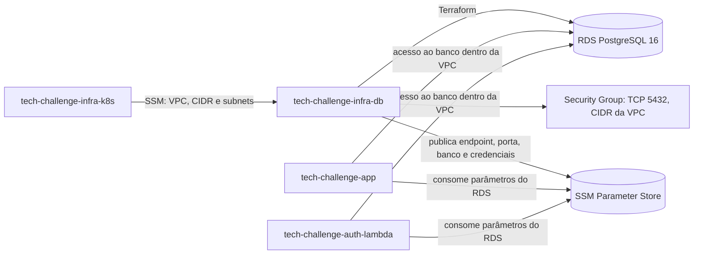

# Banco de dados gerenciado

Terraform para provisionar o banco PostgreSQL gerenciado do Tech Challenge na AWS e compartilhar suas configurações com os repositórios consumidores por meio do SSM Parameter Store.

## Propósito

Este repositório cria uma instância Amazon RDS PostgreSQL, seu DB Subnet Group e Security Group. A rede é criada pelo repositório `tech-challenge-infra-k8s`; este projeto consulta os parâmetros da rede no SSM, sem compartilhar Terraform state entre os projetos.

O schema da aplicação é criado pelo Flyway executado pela aplicação, não por este Terraform.

## Tecnologias

| Tecnologia | Configuração declarada |
|---|---|
| Terraform | Versão mínima `1.5`; o workflow usa `1.9.8` |
| AWS provider | `hashicorp/aws`, versão `~> 6.0` |
| Amazon RDS | Engine PostgreSQL (`postgres`), versão principal `16` |
| Instância RDS | `db.t3.micro` por padrão |
| Armazenamento | `20` GB, tipo `gp3` por padrão |
| Região AWS | `us-east-1` por padrão |

Classe, armazenamento, versão do engine, nome do banco e região são variáveis do Terraform e podem ser sobrescritos.

## Diagrama da arquitetura



O `data.tf` lê do SSM os parâmetros `/tech-challenge/vpc_id`, `/tech-challenge/vpc_cidr` e `/tech-challenge/subnet_ids`, publicados pelo `tech-challenge-infra-k8s`. Os IDs lidos compõem o DB Subnet Group. A configuração da rede informa subnets públicas; o RDS usa `publicly_accessible = false`.

Esses caminhos são os de produção. Em homologação, o prefixo é `/tech-challenge-homolog`, tanto para os parâmetros de rede consumidos quanto para os parâmetros RDS publicados. Os recursos de homologação recebem o sufixo `-homolog`; produção mantém os nomes sem sufixo.

O Security Group aceita TCP na porta `5432` com origem no CIDR completo da VPC. Não há regra de entrada para IPs externos à VPC. A descrição da regra cita nodes EKS e a Lambda de autenticação como consumidores, mas a regra é baseada no CIDR, não em Security Groups específicos.

O arquivo `ssm-outputs.tf` publica:

| Parâmetro | Tipo | Conteúdo |
|---|---|---|
| `/tech-challenge/rds_endpoint` | `String` | Endpoint do RDS |
| `/tech-challenge/rds_port` | `String` | Porta do RDS |
| `/tech-challenge/rds_db_name` | `String` | Nome do banco |
| `/tech-challenge/rds_user` | `SecureString` | Usuário master |
| `/tech-challenge/rds_password` | `SecureString` | Senha master |

`db_user` e `db_pass` são variáveis sensíveis, sem valor padrão. No GitHub Actions, os valores vêm dos secrets `TF_VAR_DB_USER` e `TF_VAR_DB_PASS` em produção, ou `TF_VAR_DB_USER_HOMOLOG` e `TF_VAR_DB_PASS_HOMOLOG` em homologação; localmente, podem ser fornecidos por `terraform.tfvars` ou pelas variáveis de ambiente `TF_VAR_db_user` e `TF_VAR_db_pass`. As credenciais publicadas no SSM são do tipo `SecureString`. Não coloque valores de credenciais neste README.

O RDS está configurado com `backup_retention_period = 0`, `skip_final_snapshot = true` e `deletion_protection = false`: não mantém backups automáticos nem snapshot final e permite exclusão sem proteção contra deleção.

## Passos de execução e deploy

### Pré-requisitos

- Terraform `>= 1.5` (o workflow fixa `1.9.8`).
- Credenciais AWS com acesso aos recursos necessários e ao bucket remoto de state.
- `tech-challenge-infra-k8s` aplicado previamente, para disponibilizar os parâmetros de rede no SSM.
- `db_user` e `db_pass` fornecidos localmente sem comitar credenciais.

### Execução local

Na raiz deste repositório:

```bash
cp terraform.tfvars.example terraform.tfvars
# Preencha db_user e db_pass no arquivo local, sem comitá-lo.
terraform init -backend-config=environments/production.s3.tfbackend
terraform validate
terraform plan -var-file=environments/production.tfvars
terraform apply -var-file=environments/production.tfvars
```

Para homologação, troque `production` por `homolog` nos caminhos dos comandos. Ao alternar entre ambientes na mesma pasta, execute `terraform init -reconfigure -backend-config=environments/homolog.s3.tfbackend` (ou o arquivo de produção correspondente).

```bash
terraform output jdbc_url
```

O output `jdbc_url` fornece a URL JDBC para `SPRING_DATASOURCE_URL`.

No PowerShell, use `Copy-Item terraform.tfvars.example terraform.tfvars` no lugar de `cp`. Também é possível informar as credenciais por `TF_VAR_db_user` e `TF_VAR_db_pass` no ambiente local.

O backend remoto S3 está configurado em `providers.tf`: bucket `tech-challenge-gp15-00` e região `us-east-1`. A chave vem do arquivo de backend do ambiente: `infra-db/terraform.tfstate` em produção e `homolog/infra-db/terraform.tfstate` em homologação. O bucket precisa existir antes de `terraform init`. Para remover os recursos de produção, execute `terraform destroy -var-file=environments/production.tfvars`, após inicializar o backend correspondente; para homologação, use o arquivo daquele ambiente. A exclusão também remove os parâmetros SSM gerenciados pelo state selecionado.

### Pipeline CI/CD

O workflow está em [`.github/workflows/terraform.yml`](.github/workflows/terraform.yml).

- **Push em `main` ou `homolog`:** executa `plan` e, se ele passar, `apply` automático. `main` seleciona produção; `homolog` seleciona homologação.
- **Pull Request para `main` ou `homolog`:** executa somente `plan`, usando o ambiente da branch de destino.
- **`workflow_dispatch`:** permite escolher `plan`, `apply` ou `destroy`. Todos passam pelo job `plan`; `apply` e `destroy` executam depois dele. A branch `homolog` seleciona homologação; qualquer outra branch seleciona produção.
- **Etapas do plan:** checkout, verificação dos secrets do banco, configuração das credenciais AWS e do Terraform, `terraform fmt -check -recursive` (com `continue-on-error`), `terraform init` com o backend do ambiente, `terraform validate` e `terraform plan` com o arquivo de variáveis do ambiente. Falha do `plan` interrompe os jobs dependentes.
- **Etapas de apply/destroy:** checkout, configuração AWS e Terraform, `terraform init` e o comando correspondente com `-auto-approve` e o arquivo de variáveis do ambiente; o apply também executa `terraform output`. Esses jobs usam o GitHub Environment `production` ou `homolog` conforme a branch. O apply não reutiliza o arquivo `tfplan` gerado pelo job de plan.

O workflow usa os secrets AWS `AWS_ACCESS_KEY_ID`, `AWS_SECRET_ACCESS_KEY` e `AWS_SESSION_TOKEN`, além de `TF_VAR_DB_USER` e `TF_VAR_DB_PASS` em produção ou `TF_VAR_DB_USER_HOMOLOG` e `TF_VAR_DB_PASS_HOMOLOG` em homologação. A concorrência é agrupada por branch de destino/ref, com `cancel-in-progress: false`.

<!--
## Fluxo de branches

O workflow confirma plan em PR para `main` e `homolog`, apply após push nessas branches e execução manual para plan/apply/destroy. `main` usa produção e `homolog` usa homologação. Proteção das branches, PR obrigatório e regras de aprovação/promoção: **[AJUSTAR: confirmar nas configurações do GitHub]**.
-->

## Links

- Swagger local: <http://localhost:8080/swagger-ui.html>
- Coleções [Postman](postman/): [acompanhamento](postman/acompanhamento.collection.json), [atendimento](postman/atendimento.collection.json), [estoque](postman/estoque.collection.json) e [coleção completa](postman/Tech-Challenge-Completa-Production.collection.json).
- [Documentação arquitetural](docs/README.md)
- [tech-challenge-app](https://github.com/postech-grupo-16/tech-challenge-app)
- [tech-challenge-infra-k8s](https://github.com/postech-grupo-16/tech-challenge-infra-k8s)
- [tech-challenge-auth-lambda](https://github.com/postech-grupo-16/tech-challenge-auth-lambda)

Os nomes dos repositórios e a pasta `docs/` da aplicação foram referenciados conforme o contexto fornecido. Os arquivos de documentação externos não foram verificados.

## Ordem de execução entre repositórios

1. Aplicar `tech-challenge-infra-k8s`, que fornece `/tech-challenge/vpc_id`, `/tech-challenge/vpc_cidr` e `/tech-challenge/subnet_ids` no SSM.
2. Aplicar este repositório, que cria o RDS e publica `/tech-challenge/rds_endpoint`, `/tech-challenge/rds_port`, `/tech-challenge/rds_db_name`, `/tech-challenge/rds_user` e `/tech-challenge/rds_password`.
3. Configurar/deployar `tech-challenge-app` e `tech-challenge-auth-lambda` para consumir os parâmetros do RDS.

Em homologação, siga a mesma ordem usando os parâmetros com prefixo `/tech-challenge-homolog` em todos os repositórios.
